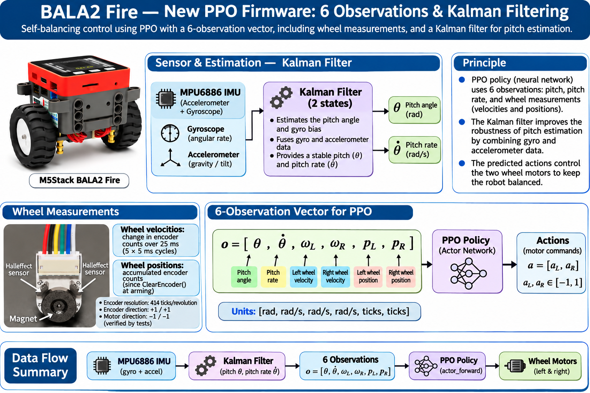
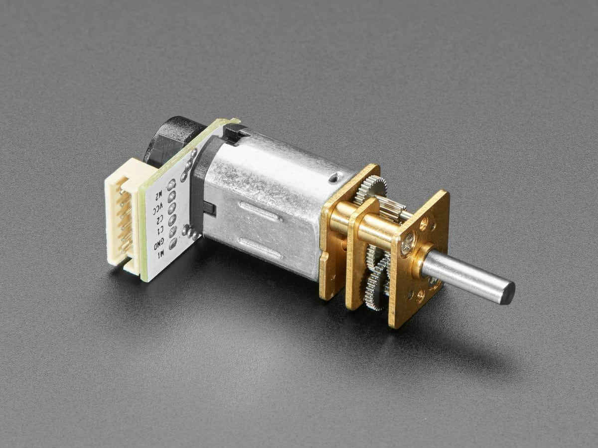
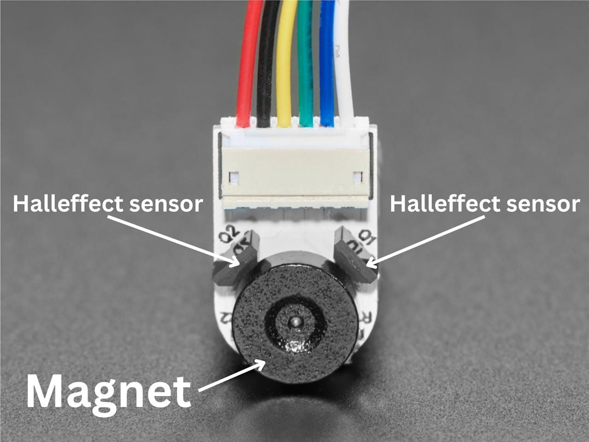

# Improving M5Stack BALA2 Balance with Reinforcement Learning

**An experimental extension of Shawn Hymel's Reinforcement Learning for Robotics project, exploring six-observation PPO control and Kalman-based IMU estimation for the M5Stack BALA2 balance robot.**

## Acknowledgments and original project

This project builds on the excellent work of **Shawn Hymel**:

**[ShawnHymel/reinforcement-learning-for-robotics](https://github.com/ShawnHymel/reinforcement-learning-for-robotics/tree/main)**

His project provides the foundation for training a reinforcement-learning agent in MuJoCo and deploying it to a real two-wheeled self-balancing robot. This repository documents my experiments to extend that approach and explore whether additional encoder information and improved orientation estimation can reduce oscillations and improve stability on the **M5Stack BALA2**.

All credit for the original project and approach belongs to Shawn Hymel. The changes described below are my experimental extensions, not modifications endorsed or validated by the original author.

## Motivation

When testing the original agent on my BALA2, I observed that the robot did not settle into a stable upright position as quickly as I had hoped. It exhibited noticeable oscillations while trying to balance.

My working hypothesis is that the original four observations do not fully capture the state needed for rapid, precise stabilization. In particular, wheel angular velocity is estimated from encoder changes over a time interval: it cannot be calculated from a single position sample and can be quantized or noisy at low speeds. **This does not mean that velocity is inherently delayed in every implementation**, nor does it establish that missing wheel position is the sole cause of the oscillations.

I therefore explored adding the **angular positions of both wheels**, alongside the existing angular velocities, so that the policy can use displacement information directly. I also introduced a **Kalman filter** in the real-robot firmware to estimate pitch more robustly from the IMU.

## From four observations to six

The original policy uses four observations:

1. IMU pitch angle (rad)
2. IMU pitch angular velocity (rad/s)
3. Left wheel angular velocity (rad/s)
4. Right wheel angular velocity (rad/s)

My extended policy uses **six observations**, in this order:

| Index | Observation | Unit | Source |
| --- | --- | --- | --- |
| 0 | Pitch angle | rad | IMU fusion / state estimator |
| 1 | Pitch angular velocity | rad/s | Gyroscope, with bias handling |
| 2 | Left wheel angular velocity | rad/s | Encoder position differences |
| 3 | Right wheel angular velocity | rad/s | Encoder position differences |
| 4 | Left wheel angular position | ticks | Magnetic encoder counts |
| 5 | Right wheel angular position | ticks | Magnetic encoder counts |

**Important:** these positions are *unwrapped wheel angles relative to the encoder reference set at the beginning of a run*. They are not absolute orientation measurements in a global/world reference frame. They provide the policy with wheel displacement since reset.

Including wheel positions may help the agent recognize and correct accumulated movement that is less directly represented by instantaneous wheel velocity alone. Whether this improves real-world stabilization needs to be demonstrated through repeatable comparisons under the same test conditions.

## Magnetic encoders and gearbox

The BALA2's geared DC motors use magnetic encoder sensing at the **motor shaft, before the gearbox**, with two Hall-effect sensors detecting the rotating magnet. The nominal specification used here is **7 pulses per motor-shaft revolution**, with an approximately **30:1 reduction ratio**.

Using the counting convention assumed in this project, the expected wheel-output resolution is:

$$
7\ \text{pulses/rev} \times 2\ \text{counted transitions} \times 30
= 420\ \text{counts/wheel rev}.
$$

In my own measurements, however, I obtained **414 counts per complete wheel revolution**. One possible explanation is that the gearbox's actual reduction ratio differs slightly from exactly 30:1. Encoder decoding conventions, measurement procedure and manufacturing tolerances should also be checked before drawing a firm conclusion.

For the current real-robot firmware, I therefore use the **empirically measured 414 counts/revolution** when converting encoder counts to wheel angle:

$$
\theta_{\mathrm{wheel}} =
\frac{2\pi\,N_{\mathrm{counts}}}{414}
$$

The same conversion and the same method for estimating wheel velocity should be used in simulation to minimize the sim-to-real observation gap.

### Motor and encoder photographs

*Geared DC motor with its motor-shaft magnetic encoder assembly.*

*Close-up showing the magnet and the two Hall-effect sensors used for encoder feedback.*

## Kalman filtering for IMU pitch estimation

I also added a **two-state Kalman filter** to the real-robot firmware. It combines:

- **Accelerometer measurements**, which provide a gravity-referenced pitch estimate when linear acceleration is modest.
- **Gyroscope measurements**, which provide fast pitch-rate information but are affected by sensor bias and integration drift.

The filter estimates **pitch angle** and **gyroscope bias**. Pitch angular velocity is obtained from the measured gyroscope rate after bias compensation. This is intended to give the RL agent more consistent pitch and pitch-rate observations than relying on either sensor alone.

Accelerometer-derived tilt can become unreliable during abrupt wheel accelerations or impacts. The implementation therefore needs suitable measurement validation and tuning for the actual robot.

**Sim-to-real requirement:** the estimator used to generate training observations in MuJoCo should match the estimator deployed in the firmware as closely as possible. Using a complementary filter during training and a Kalman filter on the real robot can itself introduce an observation mismatch.

## Reinforcement learning and sim-to-real work

The broader goal is to train a PPO policy that balances the robot **directly**, without adding an external PID controller or an ad hoc differential correction to the network's motor outputs.

The experimental training work explores:

- A six-dimensional observation space and two motor actions.
- Encoder quantization and wheel-velocity estimation aligned with the firmware.
- A reward that discourages tilt, excessive wheel motion, backward drift and divergence between the wheels.
- Domain randomization for uncertainties such as motor asymmetry, friction, mass, disturbances and control delay.
- Calibration of the MuJoCo motor model using measured responses from the physical BALA2.

These are active research and engineering directions. **Better real-world stability has not yet been established by controlled comparative testing**, and a smaller sim-to-real gap should not be assumed solely from improved training rewards.

## Current status

**Experimental / work in progress:**
The original four-observation controller exhibited oscillations in my tests. The six-observation controller and Kalman-based estimator are intended to investigate and potentially improve that behavior, but reproducible side-by-side results are still needed.

**Jupyter notebook execution and validation:**
The GPU version, **`train_with_ppo_dr_gpu_8_phases_Sim2Real.ipynb`**, has been executed on my local computer.
A CPU-only version, **`train_with_ppo_dr_cpu_8_phases_Sim2Real.ipynb`**, is also provided for systems without GPU acceleration. This version is expected to work correctly, but **it has not been executed or validated**. Its functionality and results therefore remain unverified.

**Planned validation:**
Planned validation includes balancing duration, RMS pitch angle, wheel displacement, wheel-position difference, motor-command oscillations, and performance on the real robot compared with MuJoCo.

**Note:** Successful notebook execution does not establish that the resulting controller is stable or reliable on the physical robot. Further experimental validation is required.

## Safety

A self-balancing robot can move unexpectedly when a policy is deployed. Test with a clear area, a way to prevent falls, and a reliable motor stop. Simulation performance does not guarantee physical stability.

## Credits

- **Original reinforcement learning tutorial, MuJoCo workflow and project inspiration:** [Shawn Hymel - Reinforcement Learning for Robotics](https://github.com/ShawnHymel/reinforcement-learning-for-robotics/tree/main)
- **Experimental extensions described in this repository:** six-observation policy input, encoder-based wheel position feedback, IMU Kalman filtering, and sim-to-real training investigations.
- **Author / Maintainer:** [Eric Cabret](https://www.linkedin.com/in/eric-cabret/), DV2000, France.

Please consult the upstream repository for its license and attribution requirements when reusing original source files.
